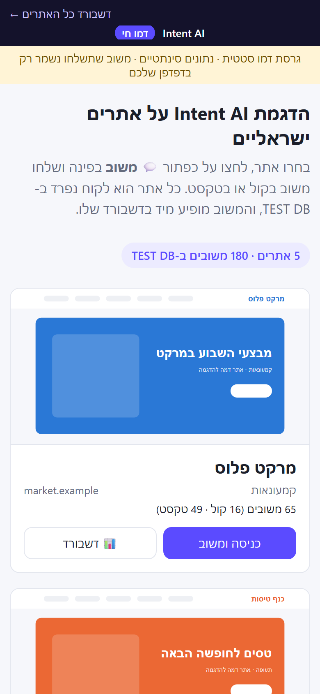
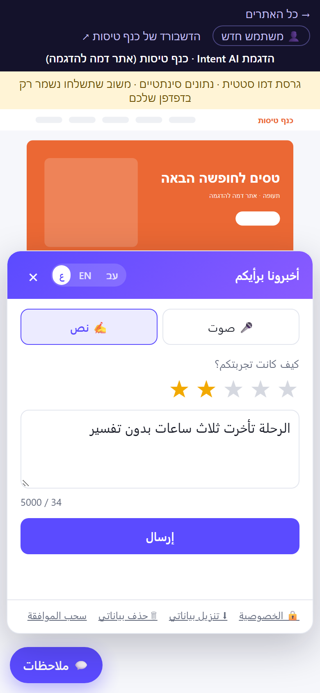
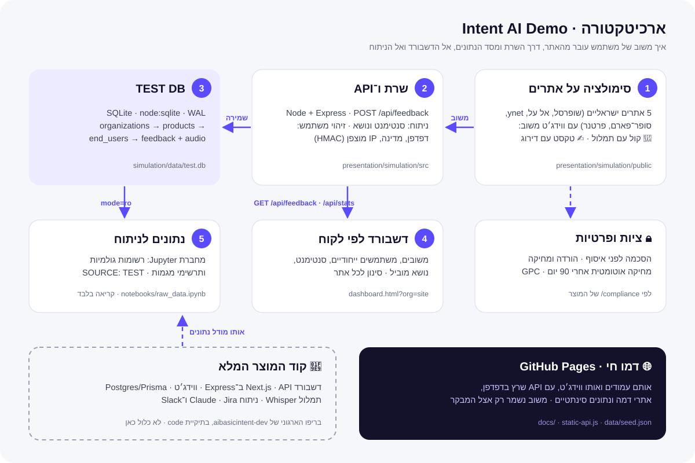
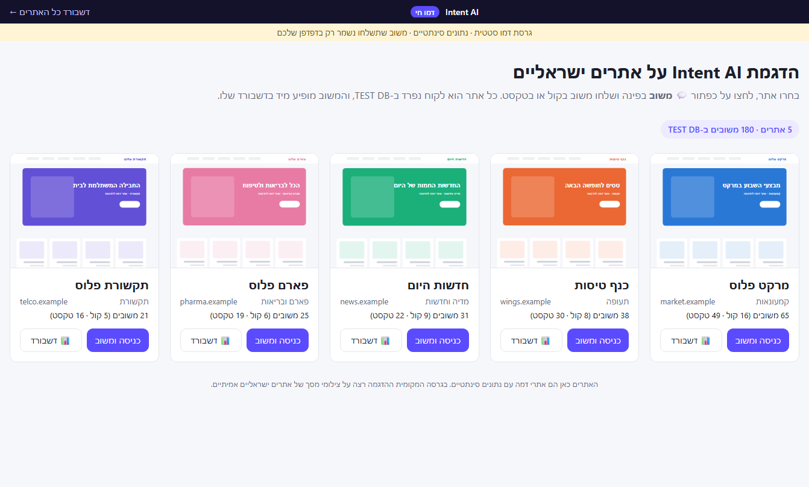
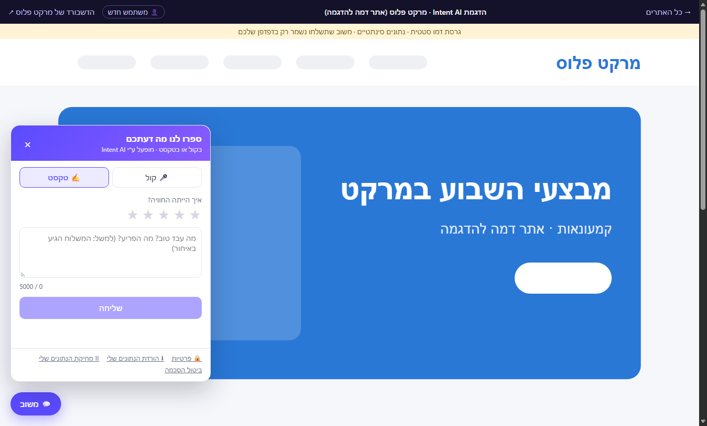
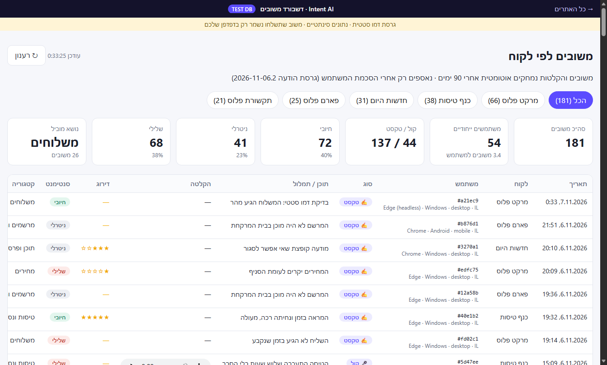
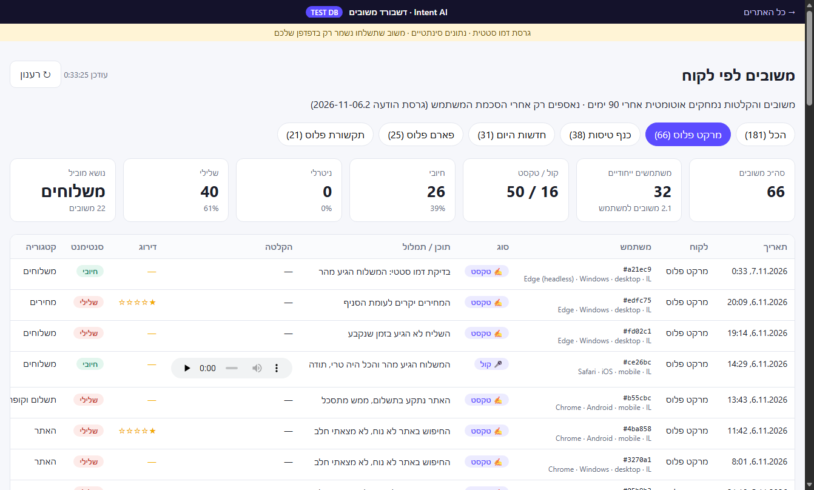
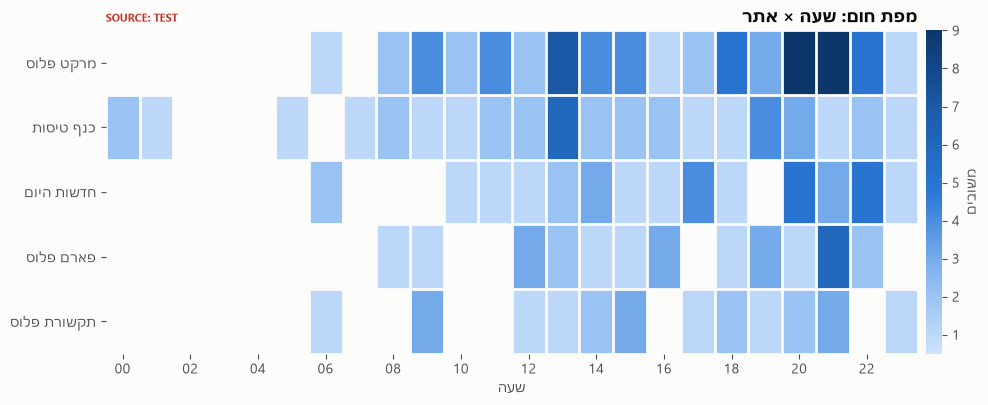
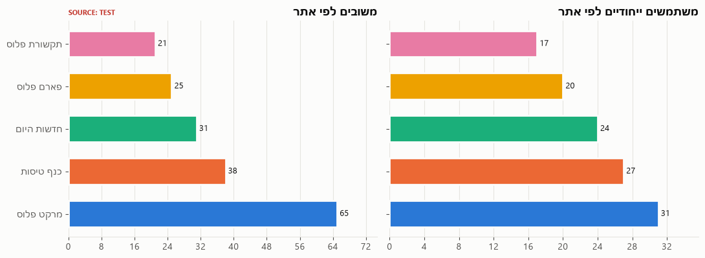

# Intent AI: הדגמה

**משוב קולי וטקסטואלי שהופך לתובנות.** משתמשים משאירים משוב באתר בקול או בטקסט, המערכת מנתחת אותו ושומרת אותו, וצוות המוצר רואה הכול בדשבורד לפי לקוח.

> 🔗 **קישור קבוע לאתרים האמיתיים (24/7, גם כשהמחשב כבוי):** https://intent-ai-demo.segevdatascience.workers.dev/ (המשובים נשמרים בענן, Cloudflare D1)
> 🌐 **דמו חי:** https://segevdatascience.github.io/INTENT_AI_Segev/ (אתרי דמה ונתונים סינתטיים. משוב שתשלחו נשמר רק בדפדפן שלכם)
> 📓 **מחברת עם תרשימים:** [`simulation/notebooks/raw_data_demo.ipynb`](simulation/notebooks/raw_data_demo.ipynb)
> 📊 **מצגת (3 שקופיות):** [`Intent-AI-overview.pptx`](Intent-AI-overview.pptx)

## הפעלה בלחיצה, ושיתוף לטלפון

| קובץ | מה הוא עושה |
|---|---|
| **[`start-demo.bat`](start-demo.bat)** | לחיצה כפולה מפעילה את ההדגמה על **8 אתרים ישראליים אמיתיים** במחשב שלך ופותחת דפדפן. בהפעלה הראשונה הוא גם מתקין את הרכיבים ומצלם את האתרים |
| **[`share-demo.bat`](share-demo.bat)** | יוצר **קישור ציבורי מאובטח (HTTPS)** עם קוד QR, לשליחה ב־WhatsApp או במייל לכל מי שתרצו. המבקר נכנס מטלפון או ממחשב ומשאיר משוב על האתרים האמיתיים, **והמשוב נשמר אצלך**, ב־TEST DB שעל המחשב שלך |

- **מבקרים לא רואים את הנתונים:** הם מקבלים רק את האתרים ואת כפתור המשוב. הדשבורד, הנתונים וההקלטות נעולים במפתח מנהל שקיים רק במחשב שלך. יש גם הגבלת קצב נגד הצפה.
- **הקישור עובד כל עוד חלון השיתוף פתוח.** בכל הפעלה נוצר קישור חדש, דרך Cloudflare Tunnel, בחינם ובלי חשבון.
- **מותאם לטלפון:** צילומי מסך ברוחב טלפון, וחלון משוב שנפתח מלמטה עם כפתורים גדולים.
- **3 שפות:** עברית, English ו־العربية, עם מתג בחלון המשוב. כיוון הטקסט, התמלול, הודעת הפרטיות וניתוח הסנטימנט מותאמים לשפה. אפשר גם לשלוח קישור עם `?lang=ar` או `?lang=en`.

| בטלפון: העמוד הראשי | בטלפון: משוב בערבית |
|---|---|
|  |  |

## ארכיטקטורה



| שכבה | מה יש | איפה |
|---|---|---|
| **1. סימולציה על אתרים** | ווידג׳ט משוב בעברית, אנגלית וערבית (קול עם תמלול, טקסט עם דירוג) מעל 8 אתרים ישראליים, במחשב ובטלפון | [`simulation/public/`](simulation/public/) |
| **2. שרת ו־API** | Node + Express. מקבל משוב, מנתח סנטימנט ונושא בשלוש שפות, ומזהה משתמשים ייחודיים (דפדפן, מדינה, IP מוצפן בלבד). במצב שיתוף הנתונים נעולים במפתח מנהל | [`simulation/src/`](simulation/src/) |
| **3. TEST DB** | SQLite דרך `node:sqlite` (מצב WAL). הטבלאות `organizations → products → end_users → feedback` והקלטות כקבצים. זה אותו מודל נתונים של המוצר (Prisma/Postgres) | `simulation/data/test.db` |
| **4. דשבורד** | משובים, משתמשים ייחודיים וסנטימנט, עם סינון לכל אתר. נשמר מאחורה ב־TEST DB ונקרא דרך ה־API | [`simulation/public/dashboard.html`](simulation/public/dashboard.html) |
| **5. נתונים לניתוח** | מחברת Jupyter שמתחברת ל־TEST DB בקריאה בלבד: רשומות גולמיות ותרשימי מגמות | [`simulation/notebooks/`](simulation/notebooks/) |
| **דמו חי** | אותם עמודים ואותו ווידג׳ט ב־GitHub Pages, עם API שרץ בדפדפן ונתונים סינתטיים | [`docs/`](docs/) |
| **קוד המוצר** | Next.js, Express, Postgres, Whisper ו־Claude. נמצא בריפו הארגוני ולא כלול כאן | aibasicintent-dev |

### לאיזה DB זה מחובר?

| סביבה | מסד נתונים | איך |
|---|---|---|
| הרצה מקומית (`start-demo.bat`) | **TEST DB, SQLite**: קובץ `simulation/data/test.db` | השרת כותב וקורא דרך [`src/db.js`](simulation/src/db.js). המחברת קוראת ישירות (`mode=ro`) |
| קישור משותף (`share-demo.bat`) | **אותו TEST DB במחשב שלך** | מבקרים מגיעים דרך Cloudflare Tunnel אל השרת המקומי. רק אתה, עם מפתח המנהל, קורא את הנתונים |
| דמו חי (GitHub Pages) | **בדפדפן**: נתונים סינתטיים מ־[`docs/data/seed.json`](docs/data/seed.json), ומשוב חדש ב־`localStorage` | [`docs/static-api.js`](docs/static-api.js) עונה לאותן בקשות `/api/...` |
| המוצר המלא | **PostgreSQL (Neon)** דרך Prisma | בריפו הארגוני |

## צילומי מסך

| העמוד הראשי: בחירת אתר | אתר עם ווידג׳ט המשוב |
|---|---|
|  |  |
| **דשבורד לכל האתרים** | **דשבורד לאתר אחד** |
|  |  |

### מתוך מחברת הניתוח



## הרצה מקומית

```bash
cd simulation
npm install
npm run capture   # צילום מסך של האתרים האמיתיים (פעם אחת, נשאר מקומי)
npm start         # http://localhost:4000   (או לחיצה כפולה על start-demo.bat)
```

| עמוד | כתובת |
|---|---|
| העמוד הראשי | http://localhost:4000 |
| דשבורד לכל האתרים | http://localhost:4000/dashboard.html |
| דשבורד לאתר אחד | http://localhost:4000/dashboard.html?org=elal |

- **דורש:** Node 22.5 ומעלה. בלי Docker ובלי מפתחות.
- **בדיקות:** `npm test` (61 בדיקות).
- **שיתוף:** `npm run share`, או לחיצה כפולה על `share-demo.bat`.
- **בניית הדמו החי:** `npm run build:static`, שכותב ל־`docs/`.
- **בהדגמה:** הכפתור "👤 משתמש חדש" מדמה מבקר נוסף.
- **ציות ופרטיות:** הסכמה לפני איסוף, הורדה ומחיקה של הנתונים, מחיקה אוטומטית אחרי 90 יום, GPC, והשרת מאזין רק מקומית. פרטים ב־[`simulation/README.md`](simulation/README.md).

## עדכונים וגרסאות
כל עדכון נדחף לשני מקורות: הריפו הארגוני (להצעת מיזוג) והריפו האישי (לתצוגה). ההנחיה ורשימת הגרסאות נמצאות ב־[`UPDATES.md`](UPDATES.md).

---
<sub>הדגמה בלבד. בדמו החי האתרים הם אתרי דמה. בגרסה המקומית מוצגים צילומי מסך של אתרים אמיתיים, שנשארים על המחשב ואין קשר בין Intent AI לבעליהם.</sub>
